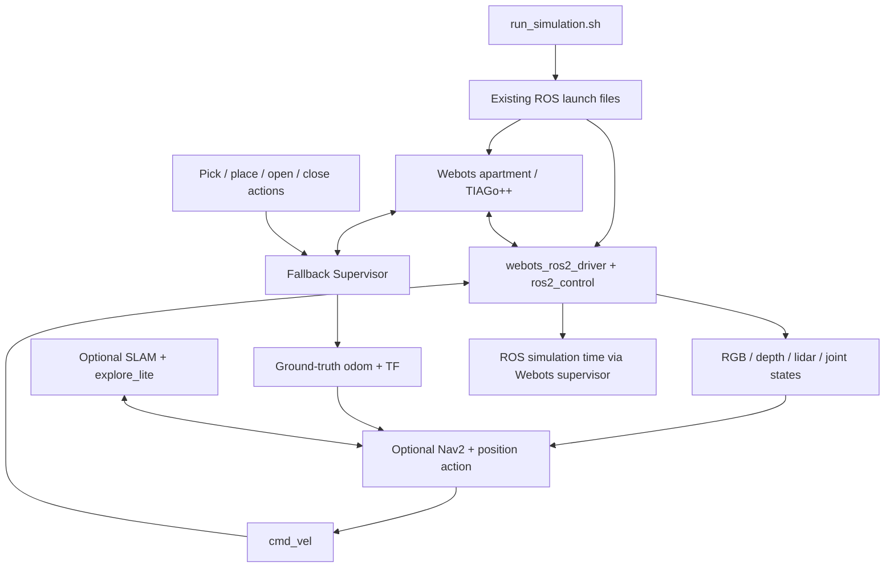

# Returning to the TIAGo apartment simulation

This is a Webots R2025a apartment with a ROS 2 Jazzy bridge, optional Nav2
navigation, SLAM/frontier exploration, and simulated object interactions.
The root is **not a ROS package**: launch files are invoked by filename. Three
small packages under `dependencies/` declare runtime requirements for basic,
navigation and mapping profiles; see [dependency audit](dependencies/README.md).
Current measurements and failures are in [VALIDATION.md](VALIDATION.md).
Older README status reports describe previous machines/runs, not this validation.



## Repository map

| Component | Responsibility |
|---|---|
| `navigate_to_position/` | ROS package: custom position action, Nav2 wrapper server, Python clients and saved-path replay |
| `simulation_actions/` | ROS package: seven manipulation/hinge action definitions and Python clients; servers run inside Webots |
| `third_party/explore/` | Vendored `explore_lite` ROS package: validated frontier goals, progress tracking and completion |
| `third_party/explore_lite_msgs/` | ROS package: exploration status message |
| `launch/` | Seven launch files (listed below), installed ROS stack integration |
| `controllers/fallback_action_supervisor/` | Single simulation loop, TCP commands, ROS action adapters, scene operations, ground-truth odometry, head gaze and mapping door preparation |
| `controllers/tiago_idle/` | Non-ROS world controller: tucked stationary arms and enabled cameras |
| `config/` | Driver URDFs, wheel/arm controllers, Nav2/SLAM/exploration settings, RViz and semantic poses |
| `worlds/`, `protos/` | Apartment scenarios, robot variants, connector-enabled objects and mesh/texture assets |
| `maps/`, `scene_graph.json` | Static maps and previous mapping outputs; scene object coordinates |
| `scripts/` | Map alignment/finalization, startup gates, semantic map tools, saved paths and runtime smoke check |
| `tests/` | Mapping/door/alignment regressions and earlier mapping verification report |
| `arrow_teleop.py`, `action_executor.py` | Keyboard drive and sequential setting-the-table ROS action client |
| `actions.md`, `TODO.md`, `third_party/README.md` | Action notes, backlog and vendored source/license provenance |

The full robot is TIAGo++ (ROS worlds name it **`TIAGo`**), with differential
drive, two arms/grippers, movable head/torso, Astra RGB/depth and Hokuyo lidar.
The default driver tucks the arms; it does not provide general arm trajectory
planning. Manipulation uses privileged Supervisor operations, connectors and
object placement, rather than a physical grasp planner. `move`/`move_to_object`
TCP operations teleport the robot; Nav2 and `/cmd_vel` drive the wheels.

## Launch files and worlds

| Launch file | Behavior |
|---|---|
| `tiago_apartment_ros2.launch.py` | Full robot, cameras, base controllers, state/TF publishers and Webots; default `setting_the_table_complete_apartment_tiago_ros2.wbt` |
| `navigation.launch.py` | Above + static map, ground-truth map anchor, scan filter, Nav2, position action server and RViz; no AMCL localization |
| `simulation.launch.py` | Selects navigation (default true) or base simulation; avoids double launching Webots |
| `make_map.launch.py` | Manual base-only mapping + SLAM/RViz |
| `tiago_apartment_mapping.launch.py` | Base-only mapping, door preparation, scan filtering, SLAM, optional exploration and automatic map/alignment saving |
| `mapping_navigation.launch.py` | Nav2 variant used by automatic mapping, omitting unused path smoother |
| `semantic_mapping.launch.py` | Navigation stack for semantic point annotation |

Other worlds: `complete_apartment_tiago_ros2.wbt` and
`unloading_groceries_complete_apartment_tiago_ros2.wbt` use the ROS full robot;
`complete_apartment_tiago_mapping.wbt` uses a base-only diagnostic robot **without
cameras or arms**. `complete_apartment_tiago.wbt` uses `tiago_idle` and the fallback
Supervisor (legacy name `TIAGo++`); `complete_apartment_turtlebot.wbt` is a legacy
external-controller variant with no dedicated launch here. `test.wbt` is an
empty arena. Local `TiagoDiagnostic`/`TiagoBaseDiagnostic` PROTOs support diagnostic
variants; connector PROTOs make selected loose objects pickable.

## Setup and daily commands

Required: Linux ROS 2 Jazzy, colcon, CMake/compiler, Python ROS/YAML modules,
Webots R2025a, `webots_ros2_driver`, `webots_ros2_control`, ros2_control base
controllers, robot_state_publisher and tf2. The optional navigation/exploration packages require Nav2 and ament lint/gtest
test dependencies. Navigation needs Nav2,
laser_filters and RViz; mapping additionally needs SLAM Toolbox. World PROTO URLs
need network access on first use unless already cached. Webots needs working
graphics/display support, including for camera rendering.

Use the [README installation instructions](README.md#fresh-installation) and
`install-dependencies.sh` to install the selected profile with rosdep. Install
Webots using `install-webots.sh` or the manual procedure. The ROS driver resolves
`ROS2_WEBOTS_HOME`, `WEBOTS_HOME`, then its standard locations (including the
official APT layout); the launcher no longer requires one absolute path.

From this repository:

```bash
./run_simulation.sh                    # full robot, cameras and manual base control
./run_simulation.sh --navigation       # add Nav2 + RViz + position action
./run_simulation.sh world:="$PWD/worlds/complete_apartment_tiago_ros2.wbt"
./test.sh                              # build + existing tests + live smoke test
```

The launcher checks manifest dependencies, Webots, executables and configuration
before incrementally building only the selected profile. Basic mode builds
`simulation_actions` and `tiago_simulation_bringup`; navigation adds its client
package/profile, and mapping adds the explorer, messages and mapping profile.
By default build/install/log directories live here and are gitignored. This
deliberately avoids writing outside the checkout. To retain the older README's
parent-workspace layout, use `SIM_WORKSPACE="$HOME/ros2_ws" ./run_simulation.sh`
(and the same variable for `./test.sh`). Do not alternate build directories for
the same source while a simulation is running. Build-only: `./run_simulation.sh --build-only`.
Both build and test phases have wall-clock timeouts; the interactive launch
runs until Ctrl-C. Only the launch's own process group is cleaned up.

In another terminal (use your chosen workspace and the same DDS domain):

```bash
source /opt/ros/jazzy/setup.bash
source install/setup.bash
export ROS_DOMAIN_ID=42                 # match the launcher; it prints its domain
ros2 node list
ros2 topic list -t
ros2 service list -t
ros2 action list -t
python3 arrow_teleop.py                 # arrows drive; q exits and sends stop
ros2 topic pub --once /cmd_vel geometry_msgs/msg/TwistStamped '{}'
ros2 topic echo /tiago/camera/color/image_raw --once --field encoding --qos-reliability best_effort
ros2 topic hz /tiago/camera/depth/image_raw
ros2 run rqt_image_view rqt_image_view
```

Do not run multiple apartment instances: the fallback server has a fixed
`127.0.0.1:8765` port, and ROS names are global. Use manual control in the base
launch; concurrent Nav2 and keyboard commands can compete.

## Interfaces (from code; live availability is not verified here)

| Interface | Type / purpose |
|---|---|
| `/cmd_vel` | Jazzy controller/teleop use `geometry_msgs/msg/TwistStamped`; check `ros2 topic type /cmd_vel` against installed controller version |
| `/odom`, `/wheel/odom` | `nav_msgs/msg/Odometry`: Supervisor ground truth versus wheel estimate |
| `/tf`, `/tf_static`, `/joint_states`, `/clock` | Transforms, joint feedback, Webots simulation time |
| `/scan` | `sensor_msgs/msg/LaserScan`; navigation also `/scan_filtered`; mapping filters `/scan_raw` into `/scan` |
| `/tiago/camera/color/image_raw`, `/tiago/camera/color/camera_info` | `sensor_msgs/msg/Image` (`bgra8`) and `CameraInfo` |
| `/tiago/camera/depth/image_raw`, `/tiago/camera/depth/camera_info` | `Image` (`32FC1`, meters) and `CameraInfo` |
| `/tiago/camera/depth/point_cloud` | Native RangeFinder point cloud interface; unverified |
| `/pick`, `/place`, `/place_to_object`, `/place_next_to`, `/place_in_container`, `/open`, `/close` | `simulation_actions/action/{Pick,Place,PlaceToObject,PlaceNextTo,PlaceInContainer,Open,Close}` |
| `/navigate_to_position` | `navigate_to_position/action/NavigateToPosition`, navigation launch only |
| Nav2 actions | Includes `/navigate_to_pose`, `/compute_path_to_pose`, `/follow_path`; discovery depends on active stack |
| Mapping topics | `/map`, `/map_metadata`, `/explore/frontiers`, `/explore/status`, `/explore/resume`, `/exploration_complete`, `/mapping/coordinate_convention` |
| Services | Controller manager list/load/switch and node parameter services; Nav2 lifecycle/planning infrastructure; mapping `/mapping_map_saver/save_map` (`nav2_msgs/srv/SaveMap`). No custom `.srv` definitions here |

Camera sizes are taken from Webots (normally 640×480). RGB and depth are offset
and **not registered**; reject nonfinite depth before using it. Frame names should
be read from actual message headers/TF: the URDF requests `Astra rgb` and
`Astra_depth`, while older README text describes `Astra_rgb`. Simulation clients
should enable `use_sim_time`; the smoke test checks clock advancement and sensor/
odometry timestamp agreement. The Supervisor stamps ground truth directly with
Webots time; its node does not explicitly set `use_sim_time`.

Examples with navigation running:

```bash
ros2 action send_goal /navigate_to_position navigate_to_position/action/NavigateToPosition \
  '{x: -1.5, y: -1.8, yaw: 1.57, frame_id: map}' --feedback
ros2 action send_goal /pick simulation_actions/action/Pick \
  '{robot: TIAGo, object: "plate(9)"}' --feedback
```

These coordinates/object names are examples, not validated safe goals for every
world. `action_executor.py` combines navigation and interactions using recorded
semantic poses. VLM interpretation belongs to external CMOC packages, not this
repository; AI agents can consume sensor topics and call the existing actions.

`test.sh` defaults to DDS domain 87 (override `SIM_TEST_DOMAIN_ID`) and refuses a
discovered occupied domain. It runs colcon tests and the basic environment/alignment/door regressions, then
the default full robot without Nav2 motion commands. `./test.sh --all` also builds
and tests the navigation/mapping profile and all Python regressions. The live
probe requires three RGB/depth/odom/clock messages, required nodes, valid image
buffers, advancing simulation time and consistent timestamps. It commands a
small in-place rotation, measures odometry response, sends zero commands and
checks stopping. It does not certify collision avoidance, Nav2 goals, grasping,
or visual robot appearance. Exit codes: 2 unavailable prerequisites,
3 build failure/timeout, 4 existing test failure/timeout, 5 live check failure/
timeout; other unexpected setup errors return nonzero. Ctrl-C returns 130.

## Suggested next work (not implemented)

| Rank | Improvement | Effort |
|---|---|---|
| 1 | Freeze the now-declared Jazzy/Webots environment in a system image and run the full live test in graphics-enabled CI | Medium |
| 2 | Install root launch/config resources as package resources; dependency profiles and path resolution are now implemented | Medium |
| 3 | Make `/cmd_vel` type, time usage and TF ownership explicit and consistent; test against the supported controller version | Small–medium |
| 4 | Validate optical frames/calibration and add a documented RGB/depth observation example; add registration only if consumers need it | Medium |
| 5 | Define an AI-agent contract with action cancellation/timeouts, capability discovery and separation of Supervisor shortcuts from physical robot skills | Medium |
